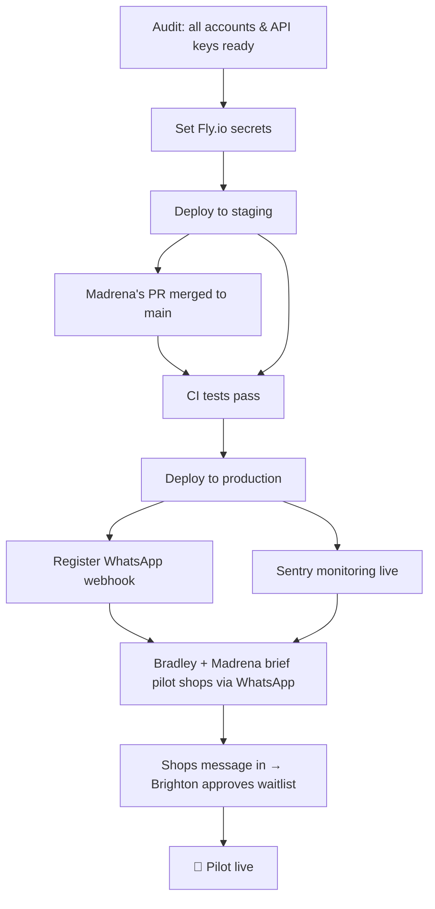

# Pilot Launch

**Status: Live as of 2026-05-25.** The bot is receiving and replying to real WhatsApp messages on production.

**As of 2026-06-10:** 14 shops on the system. 4 have recorded confirmed sales (Mai Ati, Mtetwa, Munyaradzi, Muraga — plus one unnamed shop). AakiTech Meta Business Verification completed 2026-06-10, unlocking display name in WhatsApp contact list and raising the messaging limit to 2,000/day.

Target: 20 tuck shops in Zimbabwe across two cohorts. Three-person team.

## Team

| Person | Role | Cohort |
|---|---|---|
| Brighton | Tech lead, deployment, admin approvals | — |
| Madrena | Developer, cohort lead | Cohort B (10 shops) |
| Bradley | Field mobilisation, shop onboarding | Cohort A (10 shops) |

Both cohorts are being onboarded via WhatsApp (not in-person).

## Launch sequence

## What we are trying to validate

Before looking at any metric, you have to know what you are testing. We have two core hypotheses. Both must pass for the pilot to be a success.

**Hypothesis 1 — Value:** Shop owners find it easier to send a WhatsApp message than their current method (paper, memory, or nothing), and the bot's reply is accurate enough that they trust it.

**Hypothesis 2 — Habit:** After trying it a few times, shop owners keep recording sales without being prompted. It becomes a normal part of how they run their shop.

H1 without H2 means it works but doesn't stick. H2 without H1 means people are using it out of politeness, not genuine need. Both must be true.

## Pilot success metrics

Tracked per cohort. Reviewed at end of week 2 post-launch.

### 1. Activation rate

**Definition:** % of onboarded shops that record a second sale within 7 days of their first one.

**Target: ≥50% by day 7.**

One sale could be curiosity. Two means the user found value and came back. This is the activation event — the first real signal that the product is working.

### 2. Weekly retention

**Definition:** % of originally onboarded shops that sent at least one sale message this week.

| Week | Target | Interpretation |
|---|---|---|
| Week 1 | ≥70% | Expected — most people try something new in the first week |
| Week 2 | ≥50% | The real test — novelty has worn off |
| Week 4 | ≥40% | Habit is forming — this is the PMF signal |

If week 2 drops below 30%, something is broken. Investigate immediately — do not wait for the retro.

*PMF = Product-Market Fit: when a product is solving a real problem for real people in a way that makes them want to keep using it.*

### 3. Bot accuracy (mistake rate)

**Definition:** `"Fix mistake" clicks ÷ total confirmed sales × 100`

**Target: <15%.**

Above 20%, shop owners lose trust in the bot's replies and stop using it — not because it's hard, but because they don't believe it's recording correctly. Trust is the foundation of this product.

### 4. Core action frequency

**Definition:** Average sale messages sent per *active* user per week.

No target for week 1 — observe and establish a baseline. A tuck shop makes many sales per day; if an "active" user is sending 2 messages a week, they are not using the bot as their real record. Users sending 15–20 messages per week are genuinely adopted. Understand everything about those users.

### 5. Pull signal (qualitative)

**Definition:** Did any shop owner, without being prompted:
- Ask about a feature they want?
- Report a problem they want fixed?
- Mention the bot to another shop owner?

**Target: at least one pull signal per cohort by end of week 2.**

Pull — users bringing things to us rather than us pushing everything to them — is the strongest early signal of genuine product-market fit. Its absence after two weeks is a concern.

## Review cadence

**Daily (Brighton):** Check `/admin/pilot-metrics/`. If any shop has been onboarded for more than 3 days with zero messages, flag it to the relevant cohort lead for a light-touch check-in.

**End of week 1 (Brighton + Madrena + Bradley):** Compare activation numbers per cohort. What % of each cohort hit the second-sale threshold?

**End of week 2 — formal retro (see [issue #29](https://github.com/aakitech/auto-tuck-shop/issues/29)):** Each cohort lead checks in with every active user and asks these three questions:

1. **"When do you normally send the message — right after the sale, or at the end of the day?"** Identifies what triggers the behaviour. Without a consistent trigger, the habit won't form.

2. **"Has the bot ever gotten your sale wrong? What happened?"** Surfaces accuracy problems that weren't flagged in the app — some users accept wrong records rather than tapping "Fix mistake."

3. **"If the bot stopped working tomorrow, what would you do?"** The adapted Sean Ellis test. "I'd go back to my notebook" is informative. "I'd be stuck — I don't know my numbers without it" is the pull signal in its strongest form.

## Roles during pilot

### Brighton (daily)
- Check Sentry for new errors
- Check pilot metrics dashboard: `/admin/pilot-metrics/`
- Approve new waitlist entries as shops message in
- Fix and deploy any critical bugs same day

### Madrena (daily + cohort lead)
- Monitor CI — all PRs must pass before merge
- Stay close to Cohort B shops; observe and note qualitative signals
- Pick up bugs flagged by Brighton or Bradley
- Document any changes in PR descriptions

### Bradley (daily + cohort lead)
- Stay close to Cohort A shops via WhatsApp
- Check in with each owner every 1–2 days
- Report observations back to Brighton — what's confusing, what's working, what people say
- Be the first point of contact for shop owners

## What Bradley needs to know (non-technical brief)

Bradley does not need to understand the code. He needs to know:

1. **What the bot does:** Shop owners send a WhatsApp message like "sold 5 bread at $0.50 each" and the bot records it automatically and replies with a summary.
2. **How to onboard a shop:** Get the owner's WhatsApp number. Have them send any message to the business number. Brighton approves them from the admin panel. They'll receive a welcome message automatically.
3. **What to tell owners if something goes wrong:** "Send the message again" for parsing errors. "Brighton is fixing it" for anything else. Have Brighton's number ready.
4. **How to report issues:** WhatsApp group with Brighton. Note: which shop, what they tried to do, what happened.
5. **What to write down:** Every time a shop owner says something unexpected — positive or negative — note it. That information feeds the retro.
